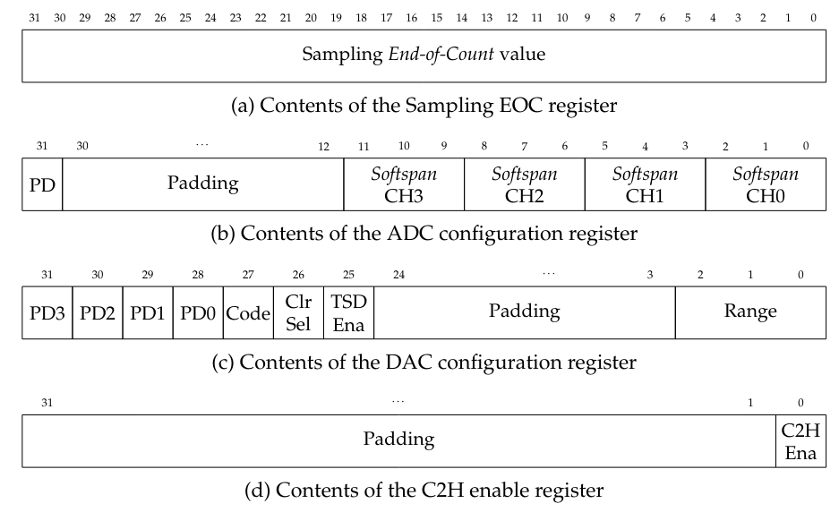

// BSP TMPE627 documentation: data flow, configuration registers and clock-domain crossing
// Author: David Andrino-Izquierdo <david.andrino@upm.es>
// Copyright: I2A2-UPM 2026
// SPDX-License-Identifier: Apache-2.0

=  BSP TMPE627
:reproducible:

NOTE: The ADC management module and channel cell, the DAC module, driver and pulse stretcher, and the TMPE627 constraint files of this BSP are TEWS Technologies reference designs and are NOT covered by the Apache-2.0 license of this project. +
Copyright (c) TEWS Technologies GmbH. +
All rights reserved. +
This Reference Design is protected by copyright laws and is provided exclusively for use with TEWS Technologies products. +
Reproduction, modification, distribution, or implementation of this Reference Design, in whole or in part, on non-TEWS products is strictly prohibited without prior written permission from TEWS Technologies GmbH.

image::images/fullBlockDesign.png[Architecture design]

This Board Support Package is designed for the TMPE627 board with an Artix-7 FPGA. It includes communication logic to implement an acquisition and processing solution on the FPGA.

== Data flow

The data flow is as follows:

* Data is acquired from 4 ADC channels (in_adc1 to in_adc4), and digital samples are received from the PCIe host.
* The acquired data is sent to the DSP module for processing.
* The processed data is sent to 4 DAC channels (out_dac1 to out_dac4) and one digital channel to the PCIe host.

== Configuration registers

The acquisition process can be configured with the configuration registers, accessed via PCIe. The registers have the following structure:

== Clock-Domain Crossing (CDC)

The design is based on two clock domains:

* PCIe clock domain (125 MHz): Obtained from the host computer, used for the XDMA and configuration registers module.
* Free-running clock (100 MHz): Obtained from an oscillator on the board, used for the acquisition datapath (ADC, DSP, DAC).

To safely transfer data between these two clock domains, two mechanisms are implemented:

* Asynchronous FIFOs: Used for digital sample transfer between the PCIe clock domain and the free-running clock domain. Implemented using Xilinx FIFO Generator IP cores. These FIFOs handle data buffering and ensure that all samples are transferred without loss.
* Handshake synchronizers: Used to send the contents of the configuration registers from the PCIe clock domain to the free-running clock domain. Unidirectional communication that only retains the last value of the registers (as previous values are not of interest).
